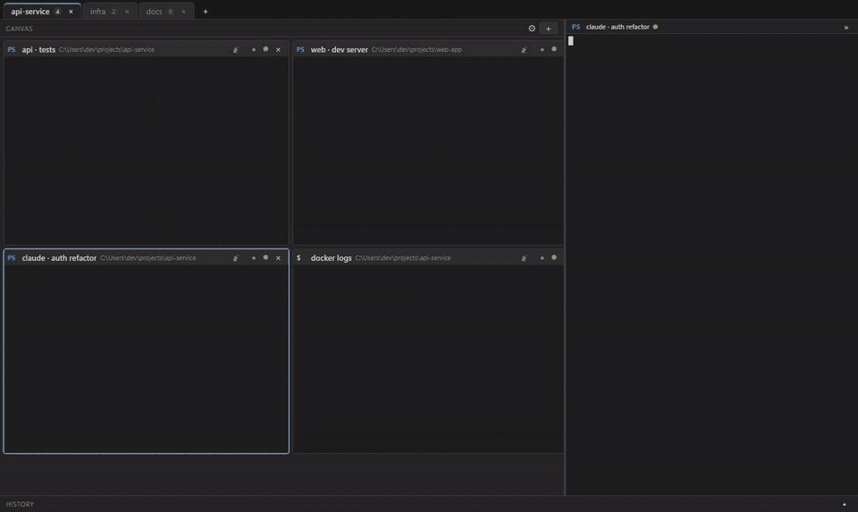

# CIBoard



Many terminals in one Windows window. Terminals flow as tiles on a canvas that re-packs itself like
a web page, the active one is mirrored in a larger focus panel, and everything you run is kept as
searchable history. Each tab is a workspace, and shells keep running while their tab is in the
background.

Built with Electron, React, xterm.js and node-pty.

## Features

- **Workspace tabs.** One tab per project. Rename, reorder by dragging, close with middle-click.
  Tabs and terminals are saved, but nothing starts when CIBoard opens: click a tab (or its Open
  workspace button) to start its shells, each in its last folder. Several workspaces can be open
  at once. Tabs you haven't opened show dimmed.
- **Responsive canvas.** Tiles never overlap. They keep their order, wrap onto new rows like
  inline blocks, and re-pack when you close, resize or drag one, so the next terminal moves into
  the gap. On a narrow window tiles stay at least about 340 px wide and wrap instead of shrinking.
- **Workflows.** Write a step-by-step plan in Markdown and CIBoard feeds it to Claude Code in a
  terminal, one step after another. See [Workflows](#workflows).
- **Claude context alerts.** If a terminal runs Claude Code, CIBoard reads the session's token
  count and raises a critical alert on that tile once it passes a limit you set (40% by default).
  The tab shows a badge so you notice it from another tab too. See [Context alerts](#context-alerts).
- **History.** Commands, working directory, exit code, duration and output are stored per session
  as Markdown, with full-text search. Passwords never reach the log, and secret patterns are masked.
- **Resource monitor.** CPU and RAM for the machine, plus a chip on every terminal.
- Broadcast typing to several terminals, find in terminal, font zoom, light and dark themes,
  PowerShell / pwsh / cmd / Git Bash / WSL profiles, and optional administrator terminals.

## Run

```bash
npm install
npm run dev
```

| Command                            | What it does                                                        |
| ---------------------------------- | ------------------------------------------------------------------- |
| `npm run dev`                      | Start CIBoard in development with hot reload                        |
| `npm start`                        | Build, then run the built app (what you ship, without hot reload)   |
| `npm run build`                    | Compile main, preload and renderer into `out/`                      |
| `npm run typecheck`                | Type-check the main and renderer code                               |
| `npm run lint` / `lint:fix`        | Check the code with ESLint / fix what it can                        |
| `npm run format` / `format:check`  | Format with Prettier / only report unformatted files                |
| `npm test` / `test:watch`          | Run the tests once / keep running them as files change              |
| `npm run check`                    | Typecheck, lint, format check and tests: run before sending changes |
| `npm run pack`                     | Unpacked build in `release/` for a quick look                       |
| `npm run dist`                     | Installer and portable exe in `release/`                            |
| `dist:installer` / `dist:portable` | Only the installer / only the portable exe                          |
| `npm run rebuild`                  | Rebuild `node-pty` for Electron (after an Electron or Node upgrade) |
| `npm run clean`                    | Delete `out/` and `release/`                                        |
| `npm run demo`                     | Rebuild and record the banner animation                             |

## Keys

| Keys                                    | Action                                    |
| --------------------------------------- | ----------------------------------------- |
| Ctrl+Shift+T                            | New terminal                              |
| Ctrl+Shift+N                            | New tab                                   |
| Ctrl+PageUp / PageDown                  | Previous / next tab                       |
| Ctrl+Tab / Ctrl+Shift+Tab               | Next / previous terminal                  |
| Ctrl+Shift+L                            | Pause or resume logging for the terminal  |
| Ctrl+Shift+B                            | Add or remove the terminal from broadcast |
| Ctrl+Shift+F                            | Find in the focus panel                   |
| Ctrl + `+` / `-` / `0`, or Ctrl + wheel | Font size                                 |
| Ctrl+,                                  | Settings                                  |

## Workflows

A workflow is a Markdown file in `docs/knowledge/` inside your project. Each `##` heading is a
step and the text under it is the prompt sent to the agent:

```md
## 1. Find the cause

agent: claude
Explain the root cause of the failing login test. Do not change any files.

## 2. Fix it

agent: claude
Make the smallest change that fixes it, then run the tests.
```

Open a terminal in your project for each agent the workflow uses, click the chain button in the
Canvas header, pick a file, check which terminal each agent gets, and press **Run all**. **From
here** on a step starts in the middle, and **Stop** ends the run.

- Steps are sent in order. A step is finished when the terminal has produced output and then been
  quiet for 8 seconds; a step that runs over 30 minutes stops the run.
- `skill: name` under a step asks the agent to use that skill (for example `skill: docx`). The
  dialog lists the skills installed on this machine, which covers your skills folder (including
  the ones synced from your claude.ai account), the project's `.claude/skills` and installed
  plugins (Claude Code skills, so this fits `agent: claude` best), and marks a step's skill with `?` when it isn't among them. Skills that exist only on
  the server and were never synced can't be seen from here.
- `gate: yes` under a step adds a **Go / No-go** box after it. The run pauses, you check the
  terminal, then press Go to continue or No-go to stop. A No-go needs a reason, and every decision
  is appended with its reason and time to `<workflow name>.decisions.md` beside the workflow.
- `agent:` picks who does the step: `claude` (the default), `codex`, `copilot` (GitHub Copilot
  CLI) or `agy` (Antigravity). Before a run, the dialog asks which terminal belongs to each agent
  the workflow uses, preselecting a terminal whose title names the agent. Each agent needs its own
  terminal, so a workflow can hand work from one agent to another in the same project. "Start each
  agent in its terminal first" types the agent's command into its terminal; **Settings > Agents**
  changes the command if a program is installed under another name (the defaults are
  `claude`, `codex`, `copilot` and `agy`).
- A project with no workflows is not left empty: the dialog lists the **built-in workflows** that
  ship with CIBoard (the samples below). **Add to project** copies one into `docs/knowledge/`, or
  **Add all** copies them all. That creates the project's knowledge base, with a short `README.md`
  explaining the format. Existing files are never overwritten, so your edits are safe. Markdown
  files there without any steps are ignored, so you can keep notes beside your workflows.
- There is no confirmation between steps. The agents can edit files, so write read-only prompts
  ("do not change any files") for the steps where you want to look first.

Samples for real work are in [`docs/knowledge/`](docs/knowledge):

| File                          | What it does                                                                                                     |
| ----------------------------- | ---------------------------------------------------------------------------------------------------------------- |
| `review-pull-request.md`      | Summarise a branch, hunt for bugs, find untested behaviour, write the review                                     |
| `fix-a-bug.md`                | Reproduce with a failing test, find the root cause, fix it, draft the commit message                             |
| `release-notes.md`            | Group commits since the last tag into user-facing notes and flag breaking changes                                |
| `team-feature-delivery.md`    | Claude plans, Antigravity checks the plan, Codex builds, Copilot reviews, Codex fixes, Claude writes the PR text |
| `onboard-to-a-codebase.md`    | Map a new project, trace one feature, list risky areas, write onboarding notes                                   |
| `security-assessment-md.md`   | OWASP scan, verify and rate findings, write a Critical-to-Low report with remediation as Markdown                |
| `security-assessment-docx.md` | The same assessment delivered as a formatted Word report                                                         |

## Context alerts

Settings > Alerts sets the limit (1-99%) and the context window size. Claude Code doesn't have to
show anything on screen: CIBoard looks for the `claude` process inside each terminal, finds its
session in `~/.claude`, and measures the tokens of the latest response against the window. The
window defaults to 200,000 tokens; a session that goes past it is measured against 1,000,000.

Each terminal is judged on its own. Dismissing an alert hides it until the session drops back under
the limit (`/compact`, `/clear`) and crosses it again. When the terminal is in another tab, or the
window isn't focused, you also get a system notification.

## Where things are

| What                | Where                                                        |
| ------------------- | ------------------------------------------------------------ |
| Settings and layout | `%APPDATA%\CIBoard\settings.json`, `layout.json`             |
| History             | `%APPDATA%\CIBoard\history\<date>\` (folder is configurable) |
| Per session         | `<time>_<shell>_<title>.md` and `.raw.txt`                   |

Structured history needs shell integration, which CIBoard injects without editing your profile
files (see `shell-integration/`). Custom profiles only get the raw transcript.

## Privacy and administrator terminals

Only what the terminal displays is logged, never keystrokes. Redaction patterns (Settings >
Privacy) mask secrets before they reach disk, logging can be paused per terminal, and history can
be deleted or expire after a number of days.

CIBoard never elevates on its own and stores no credentials. An administrator terminal runs through
Windows `sudo` (inline mode) or `gsudo`, and Windows shows the UAC prompt. Administrator terminals
restored from a layout wait for a click instead of prompting at launch.
